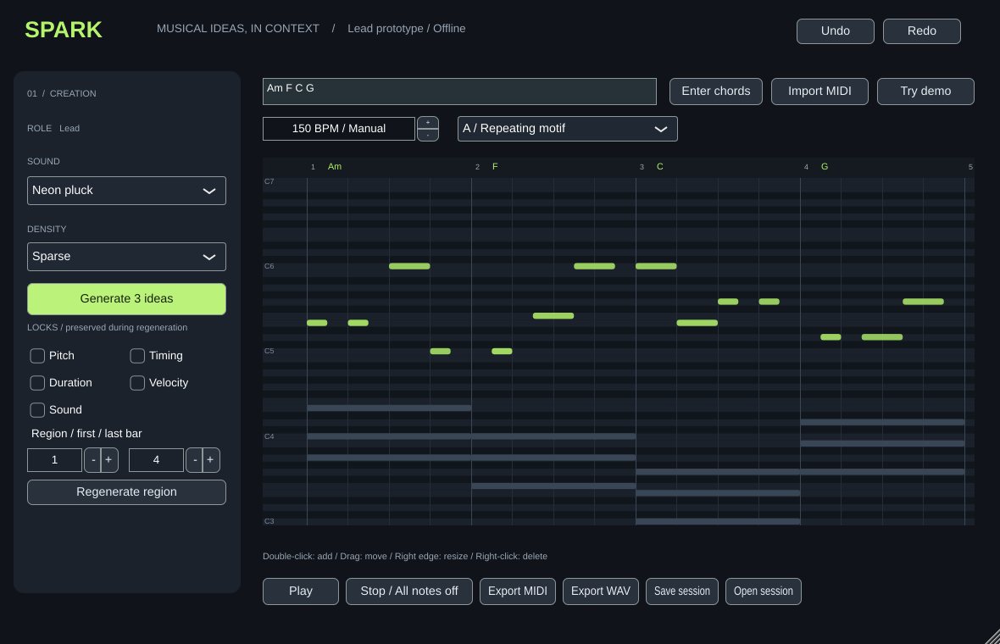

# SPARK

An offline, native generative instrument. **0.1 is a Lead workflow prototype**, not the complete first release described in [the build brief](docs/BUILD_BRIEF.md).

JUCE 8 provides VST3 and standalone wrappers; the musical engine is ordinary C++17 with no JUCE dependency. Windows is the intended production target. Linux is the development validation platform so far. No FL Studio compatibility claim is made.

## Build

Install CMake 3.22+, a C++17 compiler, and Git. On Windows use Visual Studio 2022 with Desktop development with C++. On Debian/Ubuntu install:

```sh
sudo apt-get install cmake build-essential pkg-config libasound2-dev libx11-dev libxext-dev libxinerama-dev libxrandr-dev libxcursor-dev libfreetype-dev libfontconfig1-dev libgl1-mesa-dev
```

```sh
cmake -S . -B build -DCMAKE_BUILD_TYPE=Release
cmake --build build --config Release --parallel 3
ctest --test-dir build -C Release --output-on-failure
```

JUCE is fetched from the exact 8.0.6 commit in CMakeLists.txt (requires GitHub read access). Alternatively pass `-DFETCHCONTENT_SOURCE_DIR_JUCE=/path/to/JUCE` to use a verified local checkout.

VST3: `build/SPARK_artefacts/Release/VST3/SPARK.vst3`.
Standalone: `build/SPARK_artefacts/Release/Standalone/SPARK` (`SPARK.exe` on Windows). Windows VST3 bundles belong in `C:\Program Files\Common Files\VST3`; rescan plugins in the DAW. Linux bundles are not Windows plugins.

Engine-only tests need no audio/GUI SDK:

```sh
cmake -S . -B build-core -DSPARK_PLUGIN=OFF
cmake --build build-core --parallel 3
ctest --test-dir build-core --output-on-failure
```

## Use

1. Click **Try demo**, or enter space-separated triads such as `Am F C G` and click **Enter chords**. Each manual chord is one 4/4 bar. Sharps and flats work; extensions are explicitly rejected.
2. Choose density and **Generate 3 ideas**. A repeats a short contour, B has fewer onsets, C uses a descending contour. All use local chord tones within C5–C6 / MIDI 72–84 (C4 is MIDI 60).
3. Choose A, B, or C. **Play / loop** auditions the synth. Timing is manual; the plugin does not claim host synchronization. Imported context appears as grey ghost notes and is not auditioned.
4. Double-click the roll to add; drag to move; drag the right edge to resize; right-click to delete. Editing snaps to 240 ticks (1/16). Notes can be edited beyond the initial generation register. Locks apply to edits and regeneration; adding/deleting requires all note locks to be off.
5. Set inclusive first/last bars and **Regenerate region**. Notes beginning outside the selection remain unchanged, including boundary-crossing sustains. With any property lock, event identities/count are preserved. With no note locks, the eligible phrase is replaced. Undo recovers the earlier result.
6. Choose one of four oscillator patches. The Sound lock prevents patch changes. Switching candidates or starting/stopping releases voices and restarts preview; bar-quantized switching is not implemented.
7. Export MIDI (960 PPQ, manual tempo, 4/4) or 24-bit stereo WAV (48 kHz, one-second tail, normalization off). Sound does not transfer with MIDI. WAV rendering is synchronous and limited to three minutes in this prototype.
8. Save `.spark`, then reopen it, or save the host project. Actual candidates, harmony/voicings, selected candidate, patch, tempo, seeds, and locks are saved. A future engine is not needed to reconstruct saved notes. Undo is bounded to 64 operations and is not persisted.

MIDI import merges all non-drum tracks, pairs note-ons/offs, groups nearby onsets, and preserves pitches in each voicing. Root/quality inference only recognizes triads and is approximate. This prototype retains manual tempo/4/4 and does not import tempo or meter maps. Keep the source MIDI: it is not embedded as original bytes. Do not use import for complex multitrack arrangements expecting track selection or full symbolic recognition.

## Delivery and validation

See [validation](docs/VALIDATION.md) and [remaining scope](docs/ROADMAP.md). There is no account, model inference, telemetry, cloud generation, or project upload. All generated sounds use oscillators; no third-party sound assets are bundled.

## License

Project source is provided under MIT (LICENSE). JUCE is a separate dependency licensed under AGPLv3 or a commercial JUCE license; see its LICENSE.md and https://juce.com/legal/juce-8-licence/. Distributing this plugin requires satisfying the applicable JUCE terms. The MIT license does not relicense JUCE or its bundled VST3 SDK. See docs/DEPENDENCIES.md.


